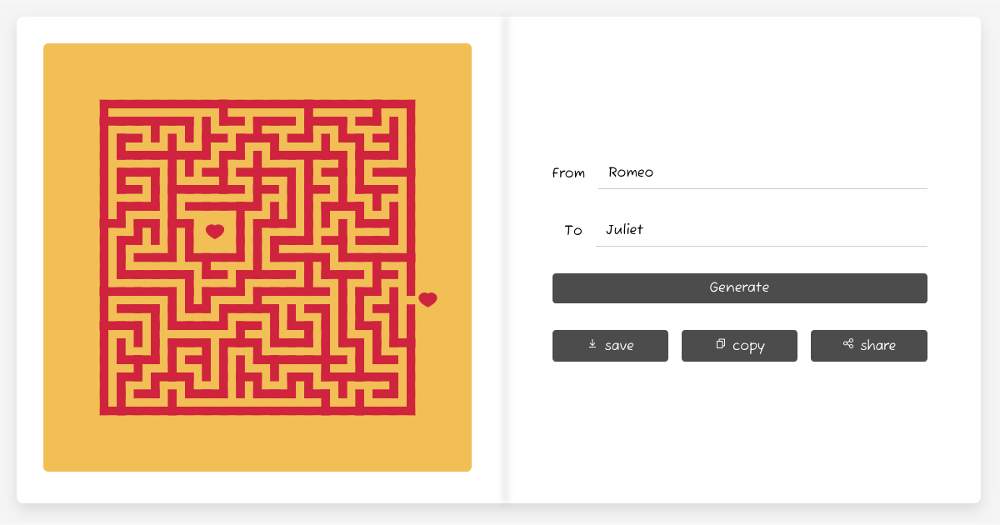

Lost in Love is a web application where you create and share a unique maze generated from two names.

## What is it?

Lost in Love is a generative art project. The software creates art autonomously based on the names you provide. Each maze is unique to those two names and can be shared with a unique URL.

## Conceptual Idea

Lost in Love explores the idea of connection and uniqueness in relationships. By using two names as the seed for randomness, each couple gets their own distinct maze—a visual metaphor for navigating love together. The maze is both shared (created from both names) and unique (no other combination will produce the same result).

## Inspiration

In a gallery in London, I came across gorgeous screenprints by Ricky Byrne. I loved their use of color and hand-produced feel—the attention to color, layout, and tension. This inspired me to experiment with maze generation algorithms in Rust with Nannou.

In the process, I decided to make it a web app for Valentine's Day, so everyone could create their own maze. I ported the Rust code to TypeScript in a tiny web app.

## How does it work?

The names you provide are used to generate unique randomness (a seed). This is fed into a maze generation algorithm using recursive backtracking—the same common algorithm featured in The Coding Train's tutorial series on maze generation.

I deliberately chose to animate the maze generation to show the process. It's slow, but I think it's interesting to watch it carve out your maze in real-time.

## What did you use?

* Nannou (Rust) for the original maze generation experiments
* p5.js for the web version
* TypeScript for type safety
* Vite for the build tooling and development server
* Recursive backtracking algorithm for maze generation