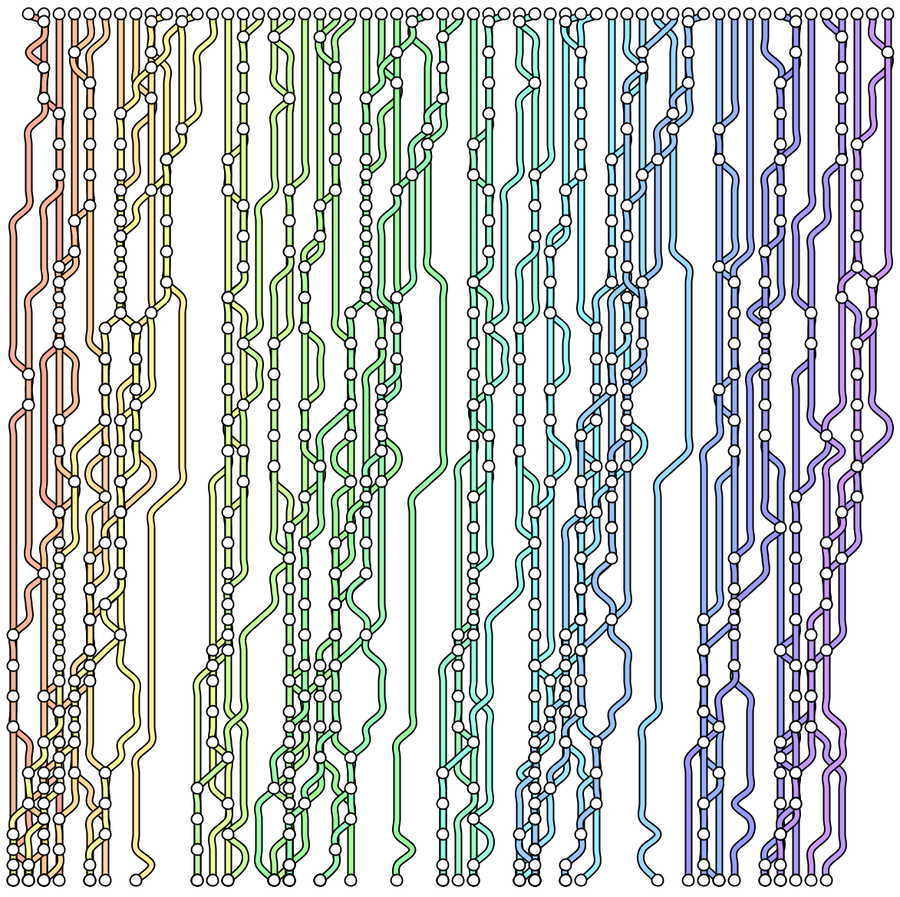
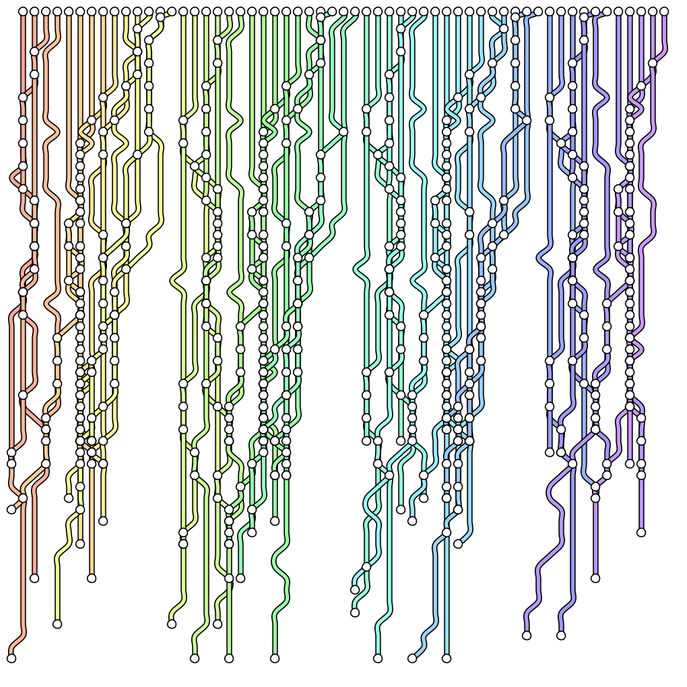
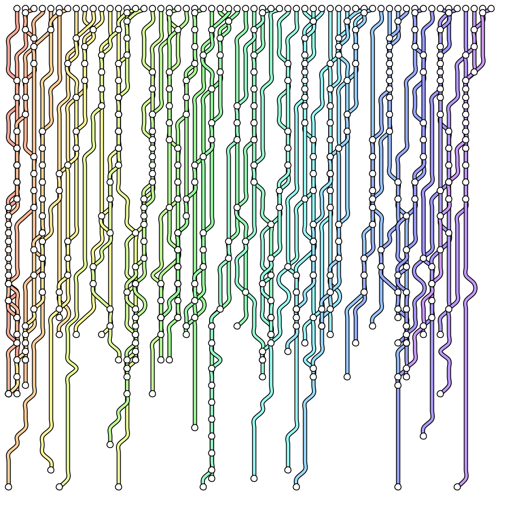
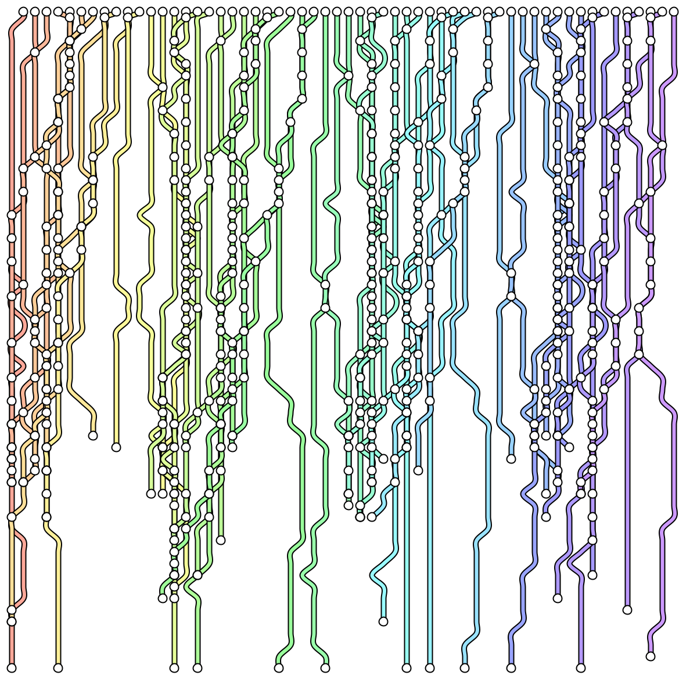
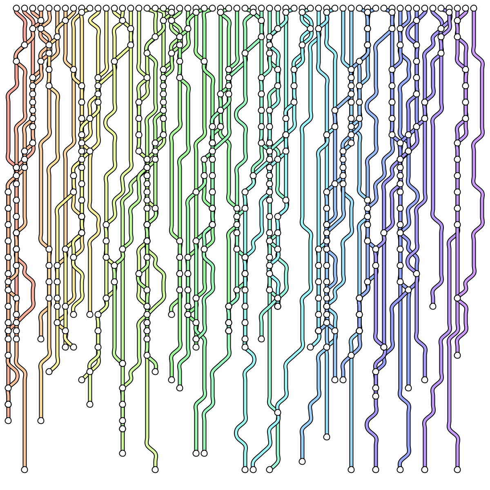

MetroMap is a generative art piece that creates abstract metro-style transit maps. 
The colors, and visual language, follow the famous metro maps. The lines are
generated randomly, and resemble water droplets forming paths when dripping down
a window.





## Inspiration

During a trip to London, I was inspired by the design elements of the London Underground map, particularly its use of color and typography to convey information at a glance.
While staring out a window on a rainy day, I noticed the patterns formed by the raindrops on the windowpane are something of a map. 

## Technology and tooling

* Processing for the rendering engine
* Algorithmic line generation
* Snapping to grids.
