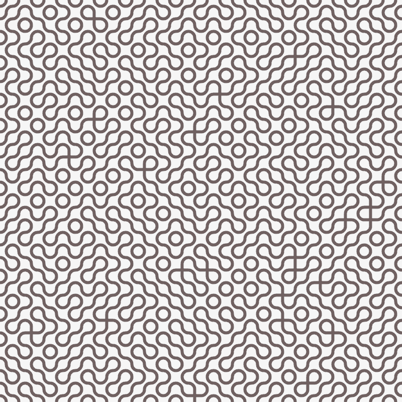
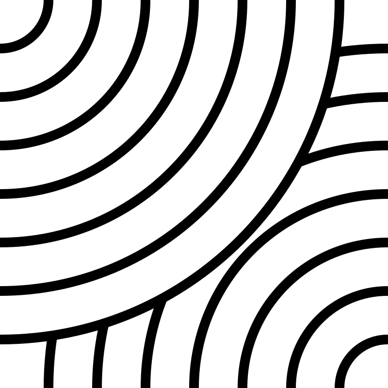
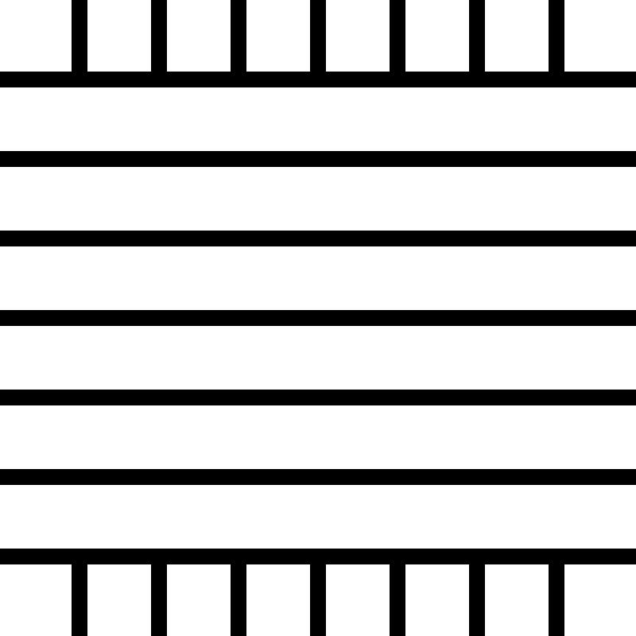
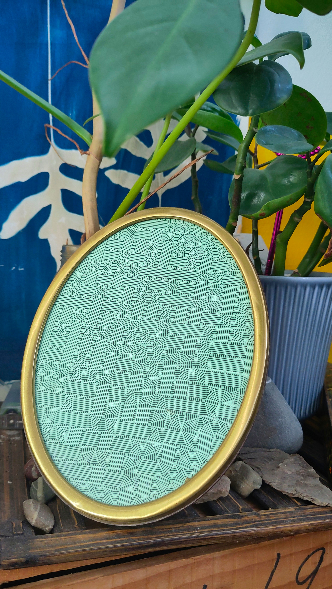
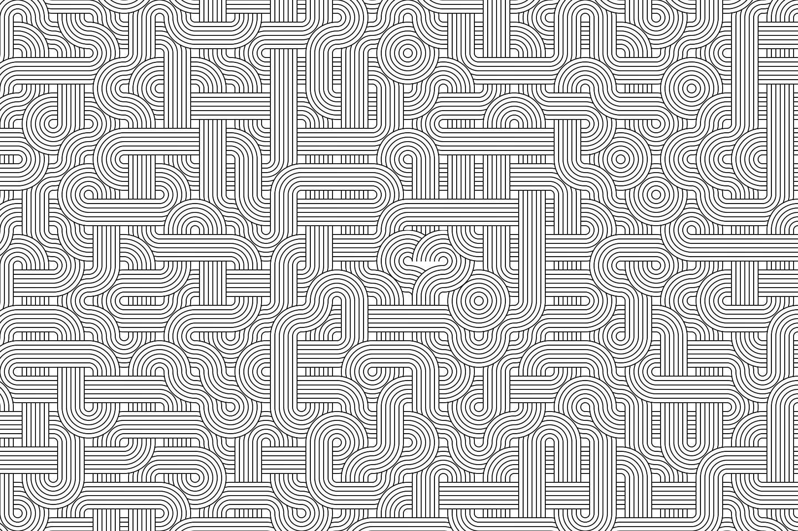

Noodle Love creates large-format compositions by placing and rotating simple tiles on a large grid.


 

When researching [Truchet tiles](https://en.wikipedia.org/wiki/Truchet_tiles), I explored ways to put the focus on the visual aspects and less on the algorithms. I wanted to create a pieces that was more about the aesthetics of the patterns than the underlying code.

A first iteration focused on the algorithm, not on the eastetics, tiles were drawn in code and I wanted to draw them in a drawing program.



 


This led me to tiles drawn by "hand", either in a vector drawing program, or by hand and then scanned. Rather than tiles drawn with code.

Additionally, the code places a special tile in the center. This tile also connects to all other tiles, but is larger. It shows a heart shape.
This makes the image look like a maze in which we can find the love, if we look carefully.




By improving the output, I can generate extremely large patterns that can themselves be tiled. Allowing me to order wrapping paper from it.

## How does it work?

1. Divide the canvas into a grid
1. Each grid cell receives one of the tiles and a rotation (0°, 90°, 180°, or 270°), randomly picked.
1. Find a center corner and place the center tile there, over any tiles that may sit there.

## Tools

* [Vormen](https://github.com/berkes/vormen) and [svg.js](https://svgjs.dev/docs/3.0/) for the code
* [Inkscape](https://inkscape.org/) for the tiles
* [Processing](https://processing.org/) for the background

## Tools

* [Vormen](https://github.com/berkes/vormen) and [svg.js](https://svgjs.dev/docs/3.0/) for the code
* [Inkscape](https://inkscape.org/) for the tiles

## Sourcecode and history

- [Processing version](https://github.com/berkes/art/tree/main/processing/NoodleLove)
- [Vormen version](https://github.com/berkes/art/tree/main/vormen/noodle_love.ts)

